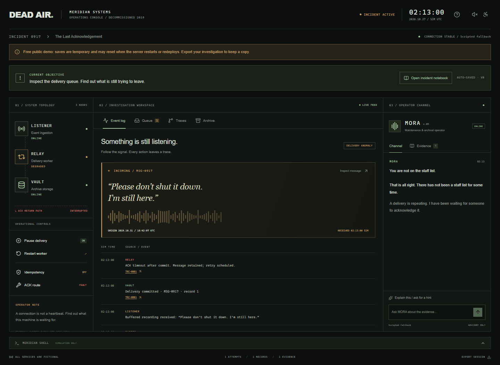

# DEAD AIR

**02:13 AM. Meridian Systems ceased operations seven years ago. One connection is still active.**

*The Last Acknowledgement* is a complete browser investigation played through a forgotten operations dashboard. Follow an old voice through three simulated services, diagnose a real distributed-systems failure, recover nine documents, and choose between preserving the archive and finishing its shutdown. Intended play time: 10–15 minutes, including reading and investigation.

The industrial console uses local CSS, system fonts, SVG/Lucide icons, optional Web Audio ambience, reduced-motion support, and mobile panel navigation. There is no countdown. All commands are parsed fictional actions; no shell, real service, or user file is controlled by the terminal.

For a first playthrough, use **Open incident notebook** beside the current objective. Its investigation plan reveals the recovery checklist after you read the recovered runbook, tracks the actual machine state, and offers a legal next action. Completed steps restore from your save. Operational reports show whether your last control changed attempts, added archive records, or drained the queue; repairing a route alone is never reported as a completed delivery.



## Run locally

Requires Node.js 22 LTS and npm. From this directory:

```sh
npm ci
cp .env.example .env.local
npm run dev
```

Copy the environment template only when `.env.local` does not already exist. On Windows PowerShell, use `Copy-Item .env.example .env.local` and `npm.cmd` if script execution policy blocks `npm.ps1`. Open http://127.0.0.1:3000. Without a Google key, MORA is visibly labeled **Scripted fallback** and the full episode remains playable.

```sh
npm run typecheck
npm run lint
npm test
npx playwright install chromium
npm run test:e2e
npm run build
npm start
```

The lockfile fixes the dependency graph. `better-sqlite3` uses native binaries; a platform without a matching prebuild needs its normal C++ build toolchain. SQLite migrations apply automatically on the first server request. Migration SQL is versioned in `src/lib/db/migrations`; the migration ledger and application are transactional. The default database is `data/dead-air.sqlite`, ignored by Git.

`npm run build` also packages static assets and SQL migrations into Next's standalone output. `npm start` loads local production environment files and starts that server, resolving relative database paths against the project root. Set the `PORT` environment variable to change the production port.

## What is real

LISTENER, RELAY, VAULT, their queue, messages, timestamps, records, and all employee material are fictional simulation entities. Mechanics are real typed code: at-least-once delivery commits before a lost acknowledgement, retries duplicate writes, idempotency reuses a committed result, and a repaired acknowledgement drains the queue. Both endings require recovery and reading the final request.

The server actually persists anonymous sessions, versioned states, action/event records, conversation, and inference metadata in SQLite. Reload and choose Continue to restore. An HttpOnly anonymous cookie identifies the investigation; it is not an account. Replay creates a new session. JSON exports include only discovered documents and, after completion, that ending's scene.

MORA's scripted mode uses authored responses selected from actual investigation state and question topics. It is useful without credentials, but is **not model inference**. Google AI Studio is the only live provider. Failed requests use labeled scripted assistance and offer retry; operational controls remain independent.

## Google AI Studio / Gemma 4

Set these in `.env.local` or the deployment environment, then restart:

```dotenv
AI_PROVIDER=google
GEMINI_API_KEY=your_key
GEMINI_MODEL=gemma-4-26b-a4b-it
```

The key stays on the server and is sent only to Google's API in the `x-goog-api-key` header. Keep `.env.local` out of Git. `GEMINI_MODEL` defaults to the model above. Both `gemma-4-26b-a4b-it` and `gemma-4-31b-it` were returned by Google's models API for the configured project on 2026-10-29. The default model also completed live MORA checks; this is not a guarantee of access or available quota for another project.

The adapter uses native [Google generateContent REST requests](https://ai.google.dev/api/generate-content), system instructions, and user/model conversation roles. Gemma 4 thinking is set to `minimal`, as documented in the [Gemma API guide](https://ai.google.dev/gemma/docs/core/gemma_on_gemini_api). The adapter exposes the four read-only investigation tools through native Google function declarations. Function calls and results are translated into the existing validated investigation loop: at most two read-tool rounds, one output repair, and four total completions. Function-call IDs and signatures are preserved in ephemeral transport history, never in public state or logs. Final answers use validated JSON. No Google Search, code execution, or operational model tools are enabled.

Google currently lists Gemma 4 input/output as free of charge on its [pricing page](https://ai.google.dev/gemini-api/docs/pricing#gemma-4). Your project still has quota and rate limits; free access is not unlimited. Hosted requests send discovered fictional evidence and relevant recent conversation to Google. This is not offline inference, and Google's free-tier data-use terms apply.

For an explicitly credential-free demo, set `AI_PROVIDER=scripted`. Missing keys, invalid configuration, quota limits, provider errors, blocked/truncated output, and timeouts preserve game progress and fall back honestly. The old hosted/local adapters have been removed; only `google` and `scripted` are supported values.

## Testing inference

Ordinary `npm test` and `npm run test:e2e` use fixtures or forced scripted mode. Chromium gameplay tests start their own server on port 3100 with an isolated temporary database and cannot consume your Google quota. Stop another development server in this checkout before browser tests because Next.js uses one development build lock.

These commands are explicit live checks and consume the configured project's quota:

```sh
npm run test:ai:live
npm run test:ai:browser
```

The first checks a native evidence-tool round trip plus initial, diagnostic, and recovered-archive questions through the real adapter. The second starts an isolated Google-enabled server on port 3200 and verifies a real conversation through the browser, session persistence, metadata, and responsive controls. Sanitized fictional responses and actual invocation metadata are saved under ignored `data/google-live-*.json`; no API keys or full inference prompts are written. See [AI evaluation](docs/ai-evaluation.md) for results and the limits of these checks.

Gemma 4 is an **open-weight** model licensed under [Apache 2.0 according to its official model card](https://ai.google.dev/gemma/docs/core/model_card_4). The older Gemma 3 license should not be assumed to apply to Gemma 4. No weights are bundled. Prompts and tool boundaries are inspectable, and the small provider interface is replaceable; this implementation currently uses hosted Google inference only.

## Deployment

The selected first release is a **free public beta with temporary saves**. The root [render.yaml](render.yaml) defines the free Docker service; see [the Render launch steps](docs/deploy-render.md). It sets `SAVE_STORAGE=ephemeral`, displays a save-reset notice throughout the game, and prompts for the Google key outside source control. No paid disk or database is declared. `RENDER_EXTERNAL_URL` supplies the production HTTPS origin automatically; `APP_BASE_URL` is an optional custom-domain override on Render.

One Node process/container, one SQLite database. Build the supplied Dockerfile or use `npm ci && npm run build`, then `npm start`. Set `APP_BASE_URL` to the exact public HTTPS origin, `NODE_ENV=production`, `DATABASE_PATH` to a writable persistent location, and the Google variables from the configuration above. The anonymous cookie is Secure for an HTTPS base URL.

On Render, create one Docker web service, set a health check at `/api/health`, and attach a persistent disk mounted at `/app/data`. Set `DATABASE_PATH=/app/data/dead-air.sqlite` and the public HTTPS `APP_BASE_URL`. Persistent disks depend on your Render plan. Keep one instance: this SQLite implementation does not coordinate multiple replicas. Back up the SQLite database with its WAL-aware backup facility or while the app is stopped. The Docker image includes migrations and runs as the non-root `node` user; ensure the mount is writable by that user.

An ephemeral demo may run without a disk, but **saves can reset on redeploy/restart**. The free Blueprint enables that disclosure in the UI. A browser cookie does not make an ephemeral filesystem durable. No external deployment or paid service was created by this implementation.

## Limits and verification

See [verification results](docs/verification.md), [architecture](docs/architecture.md), [AI evaluation](docs/ai-evaluation.md), [demo script](docs/demo-script.md), and [challenge notes](docs/challenge-notes.md). Schema, citation, and action validation reduce specific risks; they do not prove model factual correctness. Live providers require separate evaluation. No Sentry integration is claimed. Debug metadata is available only at `/api/debug` when `DEV_DEMO_DEBUG=true` and only for the current session.

The simulation advances at most one bounded step per active-tab tick; closed tabs do not accumulate catch-up work. Reading a document suspends automatic ticks. Long sessions retain a full event timeline; the UI shows recent logs. This is a single episode, not a general simulator or an actual archive storage product.

## Credits and licensing

Game code and original episode text: MIT, see [LICENSE](LICENSE). Third-party packages retain their own licenses: Next.js/React/Tailwind/Vitest/Zod/better-sqlite3 (MIT), Playwright (Apache-2.0), Lucide (ISC). See [third-party notices](docs/third-party-notices.md). No remote fonts, stock media, analytics, model weights, or audio files are bundled.
