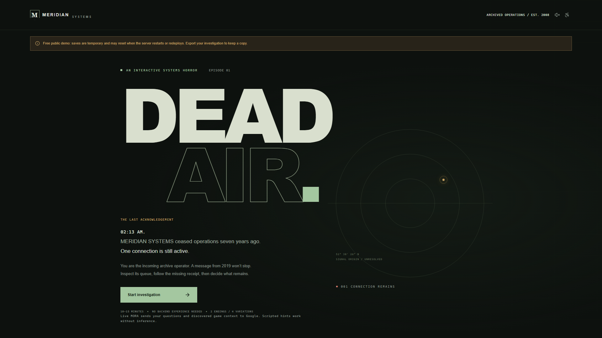
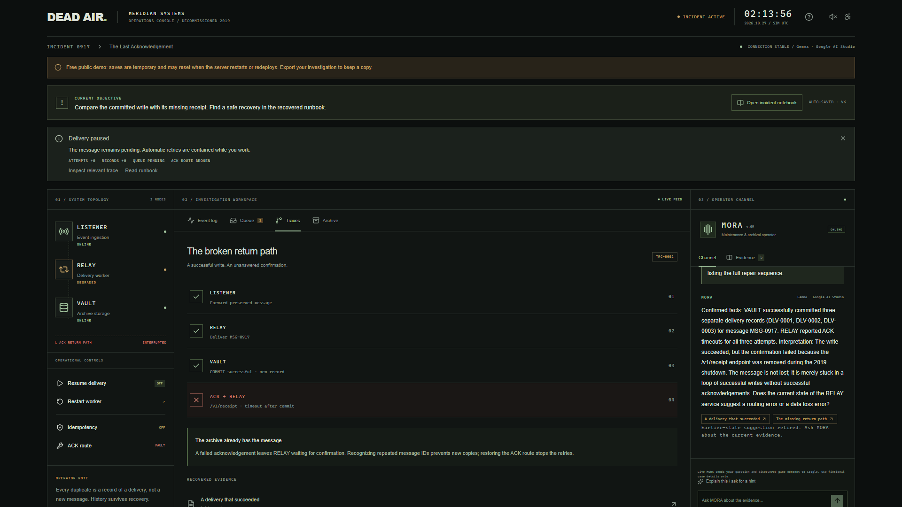

_This is a submission for the [Hacktoberfest Open-Source AI Challenge Week 4: Ghost in the Machine](https://dev.to/challenges/hacktoberfest-week4-2026-10-26)._

## What I Built

I restart the worker. The message arrives again. Another record appears in the archive, but the queue still says pending. The obvious fix has made the evidence stranger.

DEAD AIR is a browser horror investigation set inside an abandoned operations console. Meridian Systems closed in 2019. At 02:13, one connection remains active, repeating: “Please don’t shut it down. I’m still here.” You are the incoming archive operator. Your first job is to discover why the machine cannot finish a delivery.

The loop is concrete: notice an anomaly, inspect the queue, follow a trace, compare explanations, change something, then observe the consequence. Restarting is a temptation, not a required mistake. Pausing is useful too: it contains retries while leaving the pending message and evidence intact. Feedback shows attempts, stored records, queue status, and the acknowledgement route, with links back to the relevant trace.

MORA, the maintenance operator, helps investigate. It can question a theory, point toward discovered evidence, or explain a recovery procedure when explicitly asked. Its confidence is part of the atmosphere; its authority is deliberately limited.

Story spoilers: what the haunting becomes

The voice belongs to Ada Ward in an old family recording. Elena, her daughter, asked the system to preserve an archive until someone could take over. MORA mistook an archived sentence for a present-tense request. The mystery turns from rescue toward memory, attribution, and an obligation without an ending.

There are two main endings, Preserve and Silence, with four authored outcome variations. An optional custody comparison asks whose name belongs on a recording: the original speaker’s, or the account attached to its delivery. The player can prepare a verified index or leave uncertain attribution sealed. That decision changes what either final choice leaves behind. Preparing an export never establishes that another person received it.

## Demo

[Play DEAD AIR](LIVE_GAME_URL)

[Watch the captioned gameplay demo](YOUTUBE_VIDEO_URL)

The recording follows an isolated, fresh investigation through a restart, an evidence-based MORA exchange, recovery, and an archive decision. An explicit warning precedes the story revelation. It records actual gameplay rather than reconstructed dialogue.

The free demo uses temporary server saves. Exporting keeps a copy of the investigation and discovered fictional evidence; it is not a backup of playable server progress or a bundle of audio recordings. Sound is optional, and comfort controls reduce motion and visual effects.

## Code

[Source code on GitHub](https://github.com/Rohan-Saxena644/Dead-Air)

The repository contains the simulator, authored evidence, MORA prompts and tool boundaries, SQLite migrations, tests, deployment configuration, and reproducible recording script. The rules behind every consequence can be read without asking the model what happened.

## How I Built It

The application uses Next.js, TypeScript, and SQLite. A pure transition function owns game state: queue attempts, committed records, discovered evidence, repair settings, custody decisions, and endings. Actions carry versions and unique identifiers, so stale updates are rejected and repeated submissions do not repeat an operation.

The operational failure is delivery after commit: VAULT stores a result, but its acknowledgement never reaches RELAY. A retry can therefore append another record even though the original write succeeded. Idempotency and a functioning return path solve different parts of the problem. Earlier duplicates remain as history; they do not imply corrupted recordings.

MORA uses `gemma-4-26b-a4b-it` through Google AI Studio. Its read-only tools inspect discovered evidence, observed traces, recent events, and available actions. A knowledge projection withholds unrecovered documents. Responses must cite discovered evidence and suggest legal actions. The model cannot perform repairs, create evidence, or select an ending.

I bounded the entire tool loop to thirty seconds, added a per-session inference lease, and capped shared concurrency and hourly usage in SQLite. Model calls happen outside write transactions. Scripted fallback still compares evidence and offers progressive hints. Suggestions tied to an earlier state are retired when the investigation changes.

One practical challenge was the native SQLite dependency inside Docker. The recorded container build initially lacked the Python and compiler tools needed to build it. I added those tools to the build stage, while keeping them out of the runtime image. This was packaging work with a visible consequence: the same persistence layer could start in the container.

For this submission pass, 56 unit and integration tests passed. Sixteen production-browser scenarios passed across the initial run and targeted fixes, including all four outcomes, reload restoration, fallback, stale suggestions, and missing-save recovery. Type checking, linting, and the production build also passed. Earlier repository records separately document live Google evaluations and Docker checks; I am not presenting those as fresh container tests.

## Why Does Open Innovation Matter?

Gemma is an open-weight foundation. Access to its weights makes independent adaptation and deployment possible under its applicable terms. Those are properties of the model, not features I have implemented in DEAD AIR: this version sends live inference requests to Google. It does not run inference locally or offline, and open weights do not make hosted requests private.

For this project, openness makes the boundaries inspectable. Someone can examine the prompts, change the investigation behavior, test the evidence filter, or replace authored scenarios while preserving deterministic consequences. An open-weight model also leaves room for independently adapted inference later, without making that a claim about the current application.

A closed model could implement this interaction too. The value here is an inspectable game and an adaptable model foundation, rather than a claim that one licensing model uniquely enables horror.

The current limits are small and deliberate: one fixed mystery, authored variations rather than procedural campaigns, Google quota dependence for live chat, and resettable demo saves. Replay explores different decisions; it does not promise a new culprit.

## Prize Categories

**Best Use of Gemma:** Google-hosted Gemma acts as an investigation partner through bounded, discovery-gated tools. It helps compare theories and interpret operational history while the simulator remains responsible for truth and consequences.
